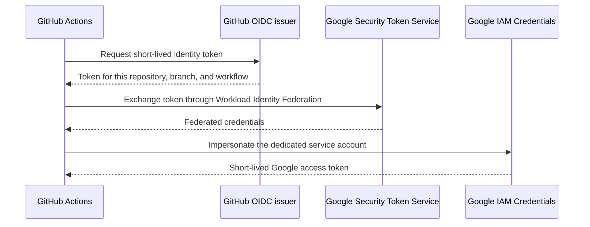

# GitHub Actions to Google Cloud with OIDC

This proof of concept lets a manually started GitHub Actions workflow authenticate to Google Cloud without a service account key. It uses Workload Identity Federation to exchange a short-lived GitHub OIDC token for a Google service account access token.

The default check proves token issuance. An optional check lists objects in an existing Cloud Storage bucket to demonstrate resource authorization. The setup script creates identity resources only when you pass `--apply`; it does not deploy an application or create a bucket.



## Requirements

- Python 3.10 or newer to generate or apply the setup plan.
- Google Cloud CLI authenticated as an administrator of an existing Google Cloud project when applying the plan.
- A GitHub repository with Actions enabled and permission to set its Actions variables.
- Internet access to Google Cloud APIs. Automatic GitHub ID lookup also needs `api.github.com`; numeric IDs can be supplied directly instead.

The setup administrator needs permission to enable the requested APIs, create a Workload Identity Pool and provider, create a service account, and set its IAM policy. Typical project roles are `roles/serviceusage.serviceUsageAdmin`, `roles/iam.workloadIdentityPoolAdmin`, and `roles/iam.serviceAccountAdmin`. The optional bucket step also requires permission to update that bucket's IAM policy. Grant these administrative roles to the setup identity only as appropriate for your organization.

The workflow service account receives no project roles. Its IAM binding grants `roles/iam.workloadIdentityUser` to the restricted federated repository identity so that it can mint service account tokens. The optional bucket check adds `roles/storage.objectViewer` on one existing bucket; that role allows listing and reading objects.

## 1. Review the setup plan

Run commands from the repository root. Replace the example project and numeric IDs with your own values. The numeric repository and owner IDs are GitHub IDs, not a repository name or username.

This command prints a plan without network lookups or cloud mutations because all IDs are supplied:

```bash
python3 oidc/setup.py \
  --project-id YOUR_PROJECT_ID \
  --project-number 123456789012 \
  --repository dblackmorris/gcp-tuts \
  --repository-id 123456789 \
  --owner-id 12345678
```

If you omit the numeric IDs, the script looks up the project number using your current `gcloud` identity and retrieves the public repository and owner IDs from the GitHub API:

```bash
python3 oidc/setup.py --project-id YOUR_PROJECT_ID
```

For a private repository or an environment where GitHub API access is restricted, supply `--repository-id` and `--owner-id` explicitly. A lookup failure does not require creating a service account key.

## 2. Apply the reviewed configuration

Run the same command with `--apply` after reviewing its output:

```bash
python3 oidc/setup.py \
  --project-id YOUR_PROJECT_ID \
  --project-number YOUR_PROJECT_NUMBER \
  --repository dblackmorris/gcp-tuts \
  --repository-id YOUR_REPOSITORY_ID \
  --owner-id YOUR_OWNER_ID \
  --apply
```

The defaults create a pool named `github-oidc-poc`, a provider named `github`, and a service account named `github-oidc-poc`. The script uses explicit create commands. An existing resource causes an error rather than an update. After a partial failure, inspect the resources and completed commands before retrying; use new `--pool-id`, `--provider-id`, or `--service-account-id` values for a separate proof of concept. Repeating an unchanged apply is not a repair mechanism.

The provider accepts only tokens matching all of these claims:

- Your numeric GitHub owner ID and repository ID.
- The `refs/heads/master` branch.
- The `workflow_dispatch` event.
- The exact workflow reference `dblackmorris/gcp-tuts/.github/workflows/oidc-poc.yml@refs/heads/master`.

The script's `--repository` and `--branch` options change the expected workflow reference. If you change the branch, also update the workflow's job condition to use that branch. A renamed workflow file requires updating the provider condition through a separately reviewed configuration change. Numeric IDs protect against a different owner or repository later acquiring the same name.

## 3. Configure GitHub Actions variables

Add these under **Settings → Secrets and variables → Actions → Variables** in your repository. They identify cloud resources and contain no credentials.

| Variable | Value |
| --- | --- |
| `GCP_PROJECT_ID` | Your Google Cloud project ID |
| `GCP_WORKLOAD_IDENTITY_PROVIDER` | `projects/PROJECT_NUMBER/locations/global/workloadIdentityPools/POOL_ID/providers/PROVIDER_ID` |
| `GCP_SERVICE_ACCOUNT` | `SERVICE_ACCOUNT_ID@PROJECT_ID.iam.gserviceaccount.com` |
| `GCP_POC_BUCKET` | Optional existing bucket name, without `gs://` or a path |

For the defaults, the pool ID is `github-oidc-poc`, the provider ID is `github`, and the service account ID is `github-oidc-poc`. Use the numeric project number in the provider resource path.

Do not add a service account JSON key. GitHub supplies the OIDC token at runtime using the workflow's `id-token: write` permission.

## 4. Run the proof of concept

Commit the new files and push them to `master` in your repository. GitHub must see the workflow on the repository's default branch before it exposes the manual dispatch control. If your default branch differs, make the branch changes described above before applying the setup.

Open **Actions → GCP OIDC proof of concept → Run workflow**, select `master`, and start the run. The workflow requests credentials, mints a five-minute access token, and checks that `gcloud` can obtain a service account access token. Tokens are discarded instead of printed. The success message confirms authentication; it does not establish permission to access project resources.

Cloud IAM changes can take several minutes to propagate. If a new setup initially reports a denied token exchange, check the configured IDs and claims, allow propagation, and rerun the workflow.

## Optional: demonstrate Cloud Storage access

Pass `--bucket YOUR_EXISTING_BUCKET` when generating and applying the plan. This adds a bucket IAM binding for the service account and enables the Cloud Storage API. Set `GCP_POC_BUCKET` to that same bucket name in GitHub Actions variables.

The workflow runs `gcloud storage ls gs://YOUR_EXISTING_BUCKET`. An empty bucket can produce no object output while the command still succeeds. Listed object names appear in the Actions log, so choose a bucket appropriate for the proof of concept. If `GCP_POC_BUCKET` is unset, the workflow skips this check.

## Local validation and troubleshooting

You can review the generated commands offline using the fully specified plan command above. Local validation cannot exercise GitHub's OIDC issuer or Google token exchange; those checks require the configured cloud resources and a run in GitHub Actions.

Run the offline tests from the repository root; they use a recording stand-in for `gcloud` and make no cloud changes:

```bash
python3 -m unittest discover -s oidc/tests -v
```

Plan mode can make read-only discovery requests if you omit numeric IDs. Apply mode checks that the project number belongs to the project ID before it creates resources. Stop after any failed setup step and inspect its error before retrying. Organization policies may restrict Workload Identity Federation, service account creation, or API activation.

- **Missing repository variable:** set the variable named by the workflow's first step.
- **Token rejected by the provider:** check the numeric IDs, `master` branch, manual event, exact workflow path, and the provider resource path.
- **Permission denied while minting a token:** check the service account's `roles/iam.workloadIdentityUser` binding, including the numeric project number and repository ID.
- **Storage permission denied:** check that the optional bucket binding was applied to the same service account and bucket configured in GitHub.
- **GitHub ID lookup fails:** provide the numeric IDs explicitly; do not put credential values in source files or chat.

The workflow's external actions are pinned to immutable commits. It grants `id-token: write` only to its authentication job and does not print tokens or upload credential files.

## Cleanup

After confirming that these resources are dedicated to this proof of concept, remove them with your actual IDs (the commands below assume the default resource names). If you configured bucket access, remove that binding first:

```bash
gcloud storage buckets remove-iam-policy-binding gs://YOUR_EXISTING_BUCKET \
  --member=serviceAccount:github-oidc-poc@YOUR_PROJECT_ID.iam.gserviceaccount.com \
  --role=roles/storage.objectViewer --condition=None --project=YOUR_PROJECT_ID
```

Then remove the identity resources:

```bash
gcloud iam service-accounts delete \
  github-oidc-poc@YOUR_PROJECT_ID.iam.gserviceaccount.com --project=YOUR_PROJECT_ID
gcloud iam workload-identity-pools providers delete github \
  --workload-identity-pool=github-oidc-poc --location=global --project=YOUR_PROJECT_ID
gcloud iam workload-identity-pools delete github-oidc-poc \
  --location=global --project=YOUR_PROJECT_ID
```

Deleted pool and provider IDs can remain reserved during the soft-deletion period. Use fresh IDs for a new experiment rather than assuming you can recreate them immediately. Remove the corresponding GitHub Actions variables and workflow when they are no longer needed. Leave shared project APIs enabled if other workloads use them.
